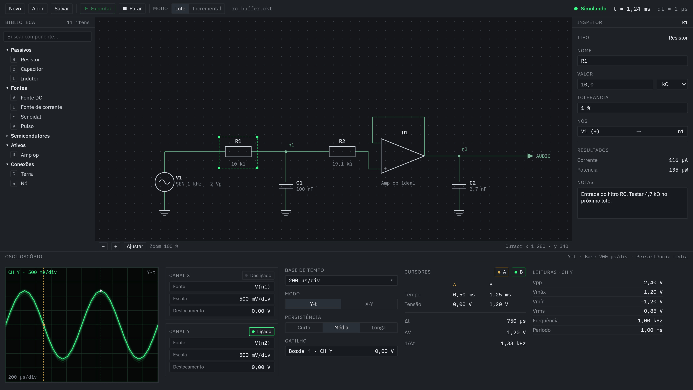

# bancada-sim

Simulador de circuitos analógicos nativo para desktop, com osciloscópio virtual de fósforo. O núcleo usa o **ngspice** como motor SPICE; a interface usa **Dear ImGui** e o osciloscópio é renderizado em **OpenGL**.

> Status: **em desenvolvimento** (Fase 0 — fundamentos e scaffold).



## Objetivos

- **Primário:** simular o circuito original do *Tennis for Two* (William Higinbotham, Brookhaven, 1958) e visualizá-lo num osciloscópio virtual.
- **Secundário:** oferecer um framework reutilizável para outros circuitos analógicos (filtros, fontes, amplificadores, osciladores) e para uso educacional.

## Recursos previstos

- Editor de esquemático com biblioteca de componentes: resistor, capacitor, indutor, fontes DC, de corrente, senoidal e pulso, amplificador operacional, terra e nós nomeados.
- Inspetor de propriedades: nome, valor com unidade, tolerância, nós conectados, resultados (corrente, potência) e notas.
- Dois modos de simulação:
  - **Lote:** transiente completo com resultado armazenado para análise.
  - **Incremental:** avanço por passos de tempo, com streaming para o osciloscópio.
- Osciloscópio virtual com canais X e Y, base de tempo, modos Y-t e X-Y, persistência de fósforo, gatilho, cursores A e B e leituras automáticas (Vpp, Vrms, frequência).
- Diagnóstico de erros com localização no esquemático (por exemplo, nó flutuante ou matriz singular).

## Arquitetura

O núcleo de simulação não depende de interface gráfica. Isso permite testar o motor pela linha de comando e reutilizá-lo em outros projetos.

```
App (GLFW + ImGui + OpenGL)
  editor · inspetor · osciloscópio
        │ edita                     ▲ lê amostras
        ▼                           │
Modelo do circuito ──▶ Netlist ──▶ Motor (ngspice, thread própria)
  (componentes como dados)           │
                                     ▼ ring buffer SPSC
                               Canais de sinal
```

Estrutura planejada:

```
bancada-sim/
├── core/       # modelo, gerador de netlist, wrapper do ngspice, sinais
├── app/        # interface ImGui e osciloscópio OpenGL
├── tools/      # simcli: executável de linha de comando sem GUI
├── tests/      # testes do núcleo
├── examples/   # rc_buffer.ckt, tennis_for_two/, ...
└── shaders/
```

## Roadmap

| Fase | Entrega | Critério de aceite |
|---|---|---|
| 1 | Núcleo e `simcli` | Circuito RC (1 kΩ, 1 µF, 5 V): em 1 ms, V ≈ 3,16 V, erro < 1 % |
| 2 | Modelo de componentes e testes | Netlist de divisor resistivo comparada com texto esperado |
| 3 | Streaming e thread do motor | 60 fps com simulação ativa, sem amostras perdidas em 10 s |
| 4 | Osciloscópio OpenGL com fósforo | Senoide de 1 kHz estável; rastro some em ~0,5 s |
| 5 | Interface completa | Montar o RC pela GUI e obter o resultado da Fase 1 |
| 6 | Tennis for Two | Comparação com o esquema histórico |

## Compilação

> Esta seção será preenchida quando o scaffold do CMake estiver pronto.

## Dependências

- [ngspice](https://ngspice.sourceforge.io/) — motor SPICE (biblioteca compartilhada, `sharedspice.h`)
- [GLFW](https://www.glfw.org/) — janela e entrada
- [Dear ImGui](https://github.com/ocornut/imgui) — interface
- [GLM](https://github.com/g-truc/glm) — matemática
- [Catch2](https://github.com/catchorg/Catch2) — testes

Todas são obtidas pelo CMake (`FetchContent`), salvo o ngspice.

## Licença

MIT. Veja [LICENSE](LICENSE).

## Referências

- Higinbotham, W. *Tennis for Two* (1958), Brookhaven National Laboratory.
- Manual do ngspice: https://ngspice.sourceforge.io/docs.html